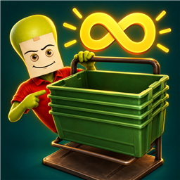

# Unlimited Universal Boxes

<p align="center">
  
</p>

<p align="center">
  <a href="https://github.com/KeyErrorFinn/roadside-research-unlimited-boxes-mod/commits/main"></a>
  <a href="https://github.com/KeyErrorFinn/roadside-research-unlimited-boxes-mod/issues"></a>
</p>

<p align="center">
  
  
  
  
  
</p>

A BepInEx mod for *Roadside Research* that removes the **150-box spawn limit** from the **Universal Box Dispenser**.

## Features

- Spawn universal boxes beyond the normal cap.
- Keeps other object spawn limits unchanged.
- Preserves dispenser cooldowns and occupied-socket checks.
- Always active when installed, with no hotkeys or configuration.

## Requirements

- Roadside Research (targets **0.2.13, build 12678**).
- BepInEx 6 IL2CPP for Windows x64.

BepInEx 5 and Unity Mono builds are incompatible.

## Installation

### Mod manager

Import `dist/Unlimited_Universal_Boxes-1.0.1.zip` into Thunderstore Mod Manager or r2modman. Install the declared BepInEx IL2CPP dependency and start the game through the same modded profile.

### Manual

1. Install [BepInExPack IL2CPP](https://thunderstore.io/c/roadside-research/p/BepInEx/BepInExPack_IL2CPP/) and run the game once to generate interop assemblies.
2. Close the game.
3. Extract the package's `BepInEx` folder beside `Roadside Research.exe`.
4. Launch through BepInEx.

The DLL belongs in `BepInEx/plugins/KeyErrorFinn-UnlimitedBoxes/`. Replace the old DLL when updating and keep only one installed copy.

## Compatibility

The release builds successfully against `BepInEx-BepInExPack_IL2CPP-6.0.788`. Spawning beyond 150, multiplayer, and loading over-limit saves after uninstalling still require in-game verification.

For co-op testing, install on the host and participating clients. Large numbers of physical boxes may reduce performance. The mod changes runtime checks and does not directly edit save files; back up your save before testing.

## Building from source

Install the .NET 6 SDK or newer, then run:

```powershell
powershell -ExecutionPolicy Bypass -File .\build.ps1
```

The script downloads a pinned BepInEx reference pack into ignored `.tools/`, verifies its SHA-256, and builds the DLL. No proprietary game assemblies are redistributed.

To use an existing BepInEx installation, copy `GameReferences.props.example` to `GameReferences.props` and set `BepInExDir`. That file is ignored so local paths stay on your machine.

## Packaging for Thunderstore

```powershell
powershell -ExecutionPolicy Bypass -File .\release\package-release.ps1
```

The upload ZIP contains the manifest, README, changelog, 256x256 icon, and plugin DLL. The script checks version agreement, icon dimensions, exact ZIP entries, and packed file hashes. It does not upload or install the package.

## Engineering notes

Universal boxes use the exact spawn-limit ID `GenericBox`. The plugin patches `Interaction.SpawnLimits.CanSpawn` for that ID and the dispenser's `SpawnObjectOnInteract.get_ReachedSpawnLimit` check for matching prefabs. Other IDs retain the game's checks.

Version 1.0.0 targeted a separate store-ordering limit and did not remove the dispenser cap. Version 1.0.1 targets the dispenser's actual spawn checks.

## Troubleshooting

| Symptom | Check |
| --- | --- |
| The limit popup still appears | Confirm version 1.0.1 is loaded in the active profile and remove duplicate DLLs. |
| The plugin does not load | Check for BepInEx 6 IL2CPP x64 and inspect `BepInEx/LogOutput.log`. |
| An incompatibility is logged | A game update may have changed the target methods; report the error with personal information removed. |

## Uninstall

Remove `KeyErrorFinn.UnlimitedBoxes.dll` and restart. The normal spawn limit returns. Loading a save with excess boxes after uninstalling has not been verified.

## Project layout

- `src/Plugin.cs`: plugin registration and spawn-limit patches.
- `release/`: Thunderstore metadata, icon, and packaging script.
- `assets/logo.png`: full-resolution logo.
- `dist/Unlimited_Universal_Boxes-1.0.1.zip`: upload package.

## Author and credits

Created by [KeyErrorFinn](https://github.com/KeyErrorFinn). Icon generated with OpenAI image generation using game reference images.

## Licence

No project-level licence is currently declared. The game, BepInEx, and other dependencies retain their own rights and licences.
